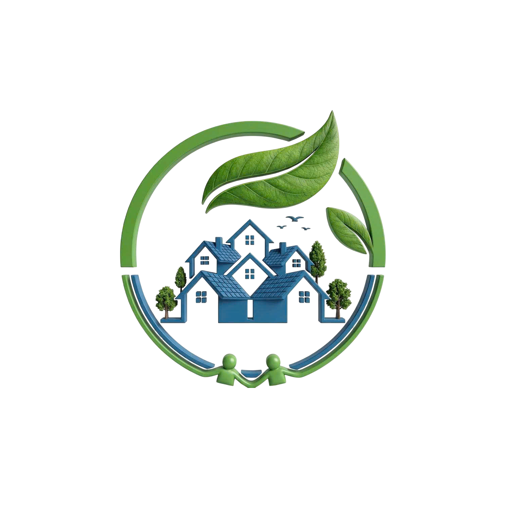
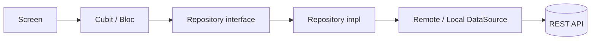

<div align="center">



# 🌱 SPEI Community

**Ứng dụng cộng đồng sống xanh: theo dõi phát thải carbon, tích điểm xanh, đổi quà và phản ánh vi phạm môi trường.**


</div>

---

## 📑 Mục lục

- [Giới thiệu](#-giới-thiệu)
- [Tính năng](#-tính-năng)
- [Ảnh màn hình](#-ảnh-màn-hình)
- [Công nghệ sử dụng](#-công-nghệ-sử-dụng)
- [Cấu trúc dự án](#-cấu-trúc-dự-án)
- [Cài đặt & chạy](#-cài-đặt--chạy)
- [Hướng dẫn sử dụng](#-hướng-dẫn-sử-dụng)
- [Quy ước phát triển](#-quy-ước-phát-triển)

---

## 📖 Giới thiệu

**SPEI Community** giúp mỗi người dùng và hộ gia đình ghi nhận lượng phát thải CO₂ hằng ngày (điện, di chuyển, môi chất lạnh…), nhận **điểm xanh** khi có hành động tích cực, đổi điểm lấy quà, đồng thời tham gia giữ gìn môi trường khu phố qua tính năng **phản ánh sự cố**. Trợ lý AI **Bạn Mầm** đồng hành giải đáp và gợi ý lối sống xanh.

---

## ✨ Tính năng

| Nhóm | Tính năng |
|---|---|
| 🔐 **Tài khoản** | Đăng ký nhiều bước, xác thực OTP, đăng nhập, khôi phục & đổi mật khẩu, đăng xuất (dọn sạch dữ liệu phiên) |
| 🏠 **Trang chủ** | Thẻ điểm xanh của bạn, lối tắt đến ví điểm, hỏi Bạn Mầm, đổi quà xanh |
| 👨‍👩‍👧 **Hộ gia đình** | Tạo hộ, tra cứu & xin tham gia hộ, mời thành viên, quản lý lời mời / yêu cầu tham gia |
| 📊 **Phát thải** | Nhập phát thải điện, di chuyển, môi chất lạnh; **tính nhanh**; lịch sử phát thải theo loại |
| 🎁 **Điểm xanh** | Xem số dư, lịch sử tích điểm, đổi quà |
| 📸 **Phản ánh sự cố** | Gửi phản ánh kèm ảnh/video (tối đa 2 ảnh + 1 video), chọn vị trí trên bản đồ, theo dõi tiến trình 5 bước, bổ sung minh chứng, xem ảnh toàn màn hình |
| 🤖 **Bạn Mầm (AI)** | Chat với trợ lý AI, hiển thị Markdown |
| 👤 **Hồ sơ** | Thông tin cá nhân, mã QR cá nhân, quét QR |

---

## 📱 Ảnh màn hình

> 💡 Đặt ảnh vào thư mục `docs/screenshots/` rồi thay tên file bên dưới cho phù hợp.

### Onboarding & Xác thực

| Splash | Onboarding | Đăng nhập | Đăng ký |
|:---:|:---:|:---:|:---:|
|  |  |  |  |

### Màn hình chính

| Trang chủ | Phát thải | Điểm xanh | Bạn Mầm |
|:---:|:---:|:---:|:---:|
|  |  |  |  |

### Phản ánh & Hộ gia đình

| Gửi phản ánh | Chi tiết phản ánh | Hộ gia đình | Hồ sơ / QR |
|:---:|:---:|:---:|:---:|
|  |  |  |  |

<!-- Thêm hàng mới bằng cách copy một bảng ở trên -->

---

## 🛠 Công nghệ sử dụng

| Mục đích | Thư viện |
|---|---|
| State management | `flutter_bloc`, `hydrated_bloc`, `equatable` |
| Điều hướng | `go_router` |
| Mạng | `dio` |
| Dependency Injection | `get_it` |
| Lưu trữ | `shared_preferences`, `flutter_secure_storage` |
| Đa ngôn ngữ | `easy_localization` |
| Media | `image_picker`, `video_player`, `permission_handler` |
| QR | `qr_flutter`, `mobile_scanner` |
| UI khác | `flutter_svg`, `pinput`, `smooth_page_indicator`, `flutter_markdown_plus` |

---

## 🗂 Cấu trúc dự án

Dự án theo **Clean Architecture** với 3 tầng: `data` → `domain` → `presentation`.

```
lib/
├── main.dart
└── src/
    ├── config/                 # Cấu hình toàn app
    │   ├── di/                 # Đăng ký dependency (get_it)
    │   ├── routes/             # Định nghĩa route (go_router)
    │   └── theme/              # Theme
    ├── core/                   # Thành phần dùng chung
    │   ├── constants/          # AppColors, hằng số
    │   ├── error/              # Failure / Exception
    │   ├── network/            # ApiClient (Dio, interceptor, refresh token)
    │   ├── services/           # LocationService, ...
    │   └── utils/
    ├── data/                   # Tầng dữ liệu
    │   ├── datasources/
    │   │   ├── local/          # Secure storage, shared prefs
    │   │   └── remote/         # Gọi API
    │   ├── models/             # DTO + fromJson/toJson
    │   └── repositories_impl/  # Cài đặt repository
    ├── domain/                 # Tầng nghiệp vụ (thuần Dart)
    │   ├── entities/
    │   ├── repositories/       # Interface
    │   └── usecases/
    └── presentation/           # Tầng giao diện
        ├── blocs/              # Cubit/Bloc theo từng tính năng
        ├── screens/            # auth, home, emission, reward, incident,
        │                       # family, mam_ai, profile, onboarding, splash, main
        └── widgets/            # Widget dùng chung (SegmentedTabBar,
                                # FullscreenImageViewer, CustomAppBar, ...)
```

**Luồng dữ liệu:**



---

## 🚀 Cài đặt & chạy

### Yêu cầu

- Flutter SDK (Dart `^3.10.3`)
- Android Studio / Xcode, thiết bị thật hoặc giả lập

### Các bước

```bash
# 1. Clone
git clone <repo-url>
cd spei_community

# 2. Cài dependency
flutter pub get

# 3. Chạy app
flutter run
```

### Cấu hình API

Base URL nằm trong [`lib/src/core/network/api_client.dart`](lib/src/core/network/api_client.dart):

```dart
_dio.options.baseUrl = 'https://speicommunity.site/api/v1';
// _dio.options.baseUrl = 'http://127.0.0.1:8080/api/v1'; // Backend local
```

### Build

```bash
flutter build apk --release        # Android
flutter build ios --release        # iOS
```

### Tạo icon & splash (khi thay logo)

```bash
dart run flutter_launcher_icons
dart run flutter_native_splash:create
```

---

## 📘 Hướng dẫn sử dụng

1. **Đăng ký / Đăng nhập** – tạo tài khoản bằng số điện thoại, xác thực OTP.
2. **Tham gia hộ gia đình** – tạo hộ mới hoặc tra cứu hộ có sẵn để gửi yêu cầu; chủ hộ có thể mời thành viên.
3. **Ghi nhận phát thải** – vào tab *Phát thải*, chọn loại (điện / di chuyển / môi chất lạnh), nhập số liệu hoặc dùng *Tính nhanh*.
4. **Tích & đổi điểm** – xem ví ở tab *Điểm xanh*, đổi quà khi đủ điểm.
5. **Phản ánh sự cố** – chụp ảnh/quay video, chọn vị trí, mô tả và gửi; theo dõi tiến trình xử lý và bổ sung minh chứng khi cần.
6. **Hỏi Bạn Mầm** – chat với trợ lý AI để được tư vấn sống xanh.

---

## 📐 Quy ước phát triển

- **Màu sắc**: dùng `AppColors`; màu chỉ dùng trong 1 màn khai báo `const` ở đầu file màn đó.
- **Widget dùng chung** đặt trong `presentation/widgets/`.
- **Đăng xuất** phải reset toàn bộ Cubit chứa dữ liệu người dùng.
- Kiểm tra code trước khi commit:

```bash
dart analyze
dart format lib
```

---

<div align="center">
Made with 💚 by SPEI Community Team
</div>
